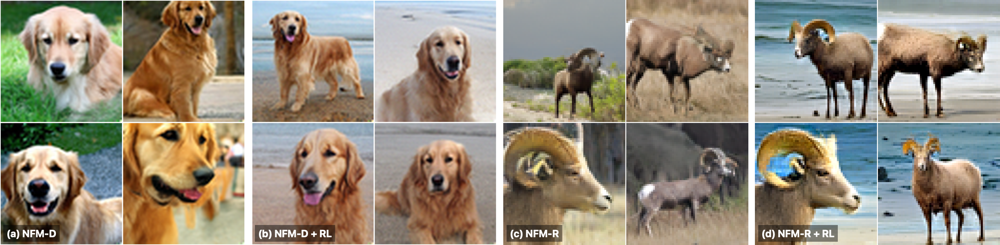

# Normalizing Flow Maps



*Image generation and post-training: NFM-D golden retrievers and NFM-R bighorn sheep, before and after RL.*

JAX implementation of the image experiments in
[**Normalizing Flow Maps**](https://arxiv.org/abs/2610.22711).
The models combine flow-map training with autoregressive normalizing flows.
This implementation branches from the public [BiFlow](https://github.com/Lyy-iiis/BiFlow)
codebase; upstream licenses and attribution are retained in [NOTICE](NOTICE).

| Branch | Contents |
| --- | --- |
| `main` | JAX: single-time and two-time CIFAR-10 NFMD, ImageNet-64 NFMD and two-stage ImageNet-64 NFMR |
| `boltzmann-generators` | PyTorch: single-system and transferable peptide Boltzmann generators |
| `reflow-couplings` | Empty branch reserved for coupling-generation code |

NFM-D and NFM-R in the paper are named **NFMD** and **NFMR** in this code.
NFMR trains in two stages: flow matching, then mean flow.

## Install

Use Python 3.12. With `uv`, the included lockfile pins the dependencies:

```bash
uv sync --frozen --python 3.12 --extra cuda --extra eval --extra nfmr
source .venv/bin/activate
```

Alternatively, use `pip` in a virtual environment:

```bash
python3 -m venv .venv
source .venv/bin/activate
pip install -e '.[cuda]'
# CPU PyTorch is used for the reference FID resize, not image-model training.
pip install torch --index-url https://download.pytorch.org/whl/cpu
pip install -e '.[eval]'
# Also install these for the NFMR perceptual losses:
pip install -e '.[nfmr]'
```

For CPU development, replace `.[cuda]` with `.[dev]`.

## Data

Prepare CIFAR-10 or your local ImageNet training images:

```bash
python -m nfm.prepare cifar10 --output data/cifar10/train
python -m nfm.prepare imagenet64 --input /path/to/imagenet/train --output data/imagenet64/train
```

ImageNet should be arranged as `train/<class>/*`. NFMR requires paired image/noise
couplings; the public coupling download is not yet available.

Create the FID reference for the dataset you use:

```bash
python -m nfm.prepare fid-reference --data data/cifar10/train \
  --image-size 32 --output data/cifar10_fid.npz
python -m nfm.prepare fid-reference --data data/imagenet64/train \
  --image-size 64 --output data/imagenet64_fid.npz
```

## One script per run

Each launcher trains, resumes from its latest checkpoint, and evaluates
periodically and at the end with 50,000 samples:

```bash
bash scripts/cifar10_nfmd.sh data/cifar10/train data/cifar10_fid.npz
bash scripts/cifar10_nfmd_twotime.sh data/cifar10/train data/cifar10_fid.npz
bash scripts/imagenet64_nfmd.sh data/imagenet64/train data/imagenet64_fid.npz
bash scripts/imagenet64_nfmr.sh /path/to/couplings.safetensors data/imagenet64_fid.npz
```

An optional third argument sets the output directory. The NFMR launcher runs
flow matching followed by mean flow. Full training settings are in the linked configs.

| Recipe | Model | EMAs | Sampling |
| --- | --- | --- | --- |
| [CIFAR-10 NFMD](configs/cifar10_nfmd.yaml) | 256 channels, 8 blocks, 6 layers, patch 2 | `0.9995`, `0.9999` | One step; CFG 0 and 2.8 |
| [CIFAR-10 two-time NFMD](configs/cifar10_nfmd_twotime.yaml) | Same size, gated affine maps | `0.9995`, `0.9999` | Two steps; EMA `0.9999`, split `0.75`, unconditional CFG 0 then conditional CFG 3.2 |
| [ImageNet-64 NFMD](configs/imagenet64_nfmd.yaml) | B/2 | `0.9995`, `0.9999` | One step; CFG 3.3 |
| [ImageNet-64 NFMR: flow matching](configs/imagenet64_nfmr_flow_matching.yaml) | B/2 | `0.999`, `0.9995`, `0.9999` | 50-step Euler; CFG 5.0 |
| [ImageNet-64 NFMR: mean flow](configs/imagenet64_nfmr_mean_flow.yaml) | B/2 | `0.999`, `0.9995`, `0.9999` | One step; CFG 4.5 on `[0.5, 0.9]` (provisional) |

## Sampling and evaluation

Use a saved checkpoint to compute FID or generate images:

```bash
python -m nfm.evaluate --config configs/imagenet64_nfmd.yaml \
  --checkpoint /path/to/checkpoint --reference data/imagenet64_fid.npz \
  --output runs/imagenet64_nfmd/evaluation
python -m nfm.evaluate --config configs/imagenet64_nfmd.yaml \
  --checkpoint /path/to/checkpoint --sample-only --samples 64 \
  --ema 0.9999 --output runs/imagenet64_nfmd/samples
```

Implementation notes and remaining reproduction details are in
[docs/provenance.md](docs/provenance.md).

## Citation

If you use this code, please cite:

```bibtex
@misc{ruscio2026normalizingflowmaps,
  title         = {Normalizing Flow Maps},
  author        = {Francesco M. Ruscio and Timothy James Hitge and
                   Fred Zhangzhi Peng and Danyal Rehman and
                   Zander W. Blasingame and Nicholas M. Boffi and
                   Michael M. Bronstein and Alexander Tong and
                   Avishek Joey Bose},
  year          = {2026},
  eprint        = {2610.22711},
  archivePrefix = {arXiv},
  primaryClass  = {cs.LG},
  url           = {https://arxiv.org/abs/2610.22711}
}
```

## License

Original NFM contributions are licensed under MIT; see [LICENSE](LICENSE).
This JAX implementation derives from [BiFlow](https://github.com/Lyy-iiis/BiFlow).
Inherited code retains its upstream copyrights and license terms, including
the Apache 2.0 and BSD terms described in [NOTICE](NOTICE).
The `boltzmann-generators` branch derives from
[Transferable Samplers](https://github.com/transferable-samplers/transferable-samplers)
and includes additional third-party terms documented in that branch's NOTICE.
