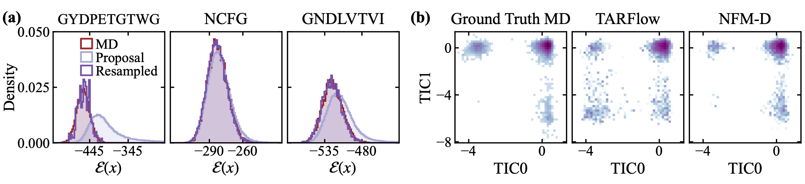

# NFMD: Boltzmann generators



*Energy distributions for single-system and transferable peptide models, and TICA projections comparing MD, TARFlow, and NFM-D.*

PyTorch implementation of the single-system and transferable peptide
Boltzmann-generator experiments in
[Normalizing Flow Maps](https://openreview.net/forum?id=guBm2gNlxU).
Image-generation code is on the [`main`](https://github.com/francescoshox/NormalizingFlowMaps/tree/main) branch.

## Install

Use Python 3.11+ and a CUDA GPU.

```bash
python -m venv .venv
source .venv/bin/activate
pip install -e .
cp .env.example .env
# Fill WANDB_PROJECT and WANDB_ENTITY in .env.
wandb login
```

## Runs

The scripts download and prepare the datasets automatically.

Train a single-system model on GYDPETGTWG or a transferable peptide model:

```bash
bash scripts/nfmd/train_GYDPETGTWG.sh
bash scripts/nfmd/train_transferable.sh
```

Evaluate a saved checkpoint:

```bash
bash scripts/nfmd/eval_GYDPETGTWG.sh --checkpoint /path/to/GYDPETGTWG.ckpt
bash scripts/nfmd/eval_transferable.sh --checkpoint /path/to/transferable.ckpt
```

See [docs/bgs.md](docs/bgs.md) for configurations and evaluation options.
Standard MLE and flow matching recipes are described in
[docs/baselines.md](docs/baselines.md).

## Attribution and license

This Boltzmann-generator implementation branches from
[Transferable Samplers](https://github.com/transferable-samplers/transferable-samplers)
and builds on its molecular sampling and training code.

Original NFM contributions are licensed under MIT; see [LICENSE](LICENSE).
Upstream MIT copyright and permission notices are retained. Inherited code
also includes Apple, NVIDIA and CC BY 4.0 terms; those files retain their
original licenses. See [NOTICE](NOTICE) and individual file headers for the
applicable terms.
